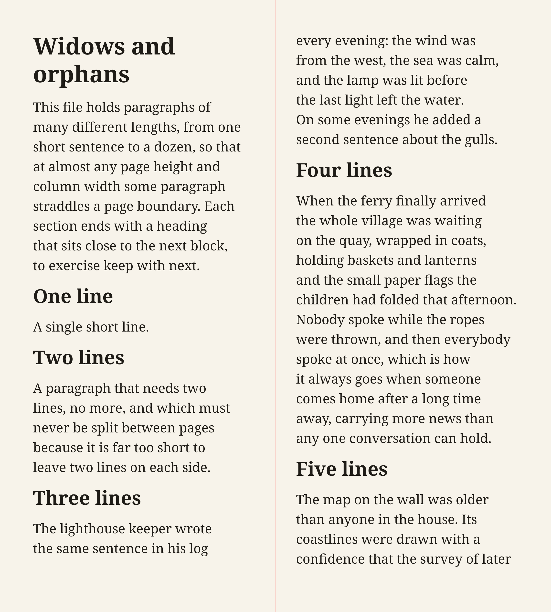
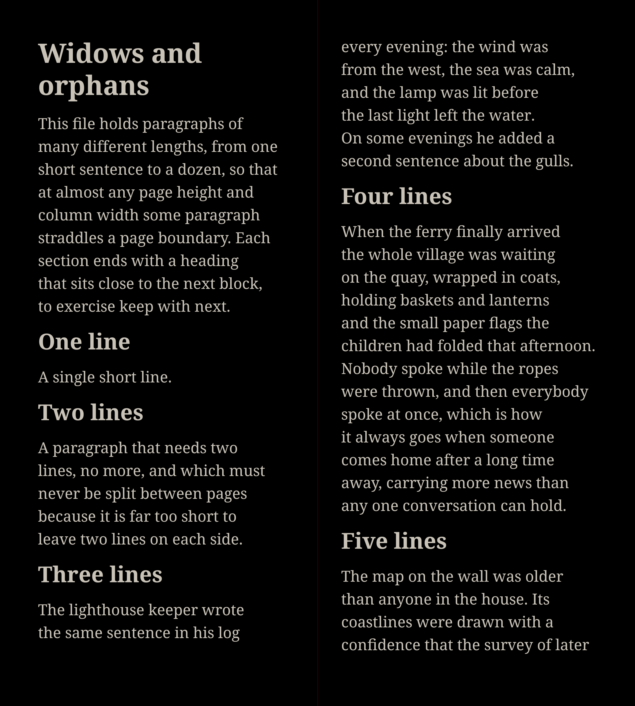

<p align="center">
  
</p>

<h1 align="center">Bifolio</h1>

<p align="center"><strong>Markdown, read like a book.</strong></p>

<p align="center">
  A quiet place for your words on Android.<br>
  One page in your hand. A spread when your screen opens.
</p>

<p align="center">
  <a href="#made-for-the-way-you-read">The reading experience</a> ·
  <a href="#install">Install</a> ·
  <a href="#build-from-source">Build</a> ·
  <a href="#privacy--license">Privacy &amp; license</a>
</p>

<p align="center"><sub>OFFLINE &nbsp; · &nbsp; READ-ONLY &nbsp; · &nbsp; FOLD-AWARE</sub></p>

---

<p align="center">
  
  <br>
  <sub>Paper · a simulated foldable spread</sub>
</p>

> *A bifolio is one sheet folded into two leaves.*

## Made for the way you read

**A page that feels like a page.** Read in paged or scrolling mode, with
considered typography, hyphenation, and four themes: Paper, Sepia, Dusk, and
Night. Adjust the type and spacing to suit your eyes.

**A spread that follows your screen.** Bifolio adapts to your window and fold
posture. On a separating book fold, the gutter follows the fold; as the layout
changes, your place in the text comes with you.

**The details stay close.** Find your way with the table of contents and search.
Read footnotes in place, view local images, and follow documents with tables,
syntax-highlighted code, and mathematical formulas.

**Your files remain yours.** Bifolio reads the files you choose and never edits
them. It has no Internet permission, accounts, advertising, or analytics.
Reading positions, recent documents, and settings stay on your device.

<p align="center">
  
  <br>
  <sub>Night · the same simulated spread, in a quieter light</sub>
</p>

## Install

Bifolio requires **Android 8.0 or newer**. Download signed APKs from
[GitHub Releases](https://github.com/idcesares/bifolio/releases).

Choose the APK for your device: `arm64-v8a` for most modern Android phones,
`armeabi-v7a` for 32-bit ARM devices, or `x86_64` for compatible emulators and
devices. Open the downloaded APK and follow Android's installation prompts;
you may need to allow your browser or file manager to install apps from that
source. Future updates must be signed with the same release key.

Open a Markdown file through Bifolio or Android's file picker. To load relative
local images, grant access to their folder when prompted. You can revoke folder
access in Settings.

## Build from source

Install JDK 21 and Android SDK Platform 37 and Build-Tools 36.0.0. The Gradle
wrapper supplies Gradle:

```sh
./gradlew :app:assembleDebug
```

On Windows, use `gradlew.bat`. See the [development environment](docs/ENVIRONMENT.md)
and [testing guide](docs/TESTING.md) for setup and verification. Release
builds require a signing key; the [release checklist](docs/RELEASE.md) describes
the process.

## Under the cover

Bifolio is a native, offline Android app. Its document model, Markdown parser,
and layout engine are separate from the Android reading surface. Reading
position is stored as a text anchor so it can survive changes in pagination.

The [specification](SPEC.md) describes the behavior; the [design system](docs/design/DESIGN.md)
sets the visual language. Architecture decisions live in [docs/adr](docs/adr/),
and the [roadmap](ROADMAP.md) records milestones and their acceptance criteria.

## Privacy & license

Read the [privacy policy](docs/PRIVACY.md). Bifolio is licensed under the
[Apache License 2.0](LICENSE); third-party notices are in [NOTICE](NOTICE),
and its independent implementation is documented in [PROVENANCE.md](PROVENANCE.md).

---

Made by Isaac D'Césares · [dcesares.dev](https://dcesares.dev) · [Contact](mailto:bifolio@dcesares.dev)
