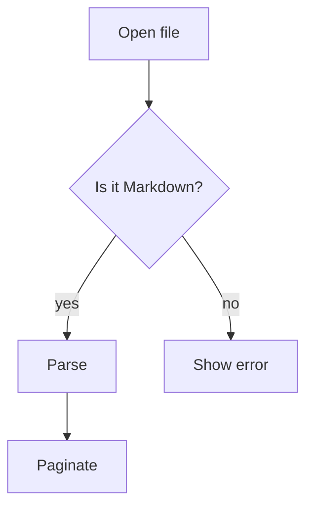

# Diagrams

A Mermaid fence is shown as source with a diagram label and is not rendered.



A normal code block follows, which must not get the diagram label.

```kotlin
fun main() {
    println("hello")
}
```
